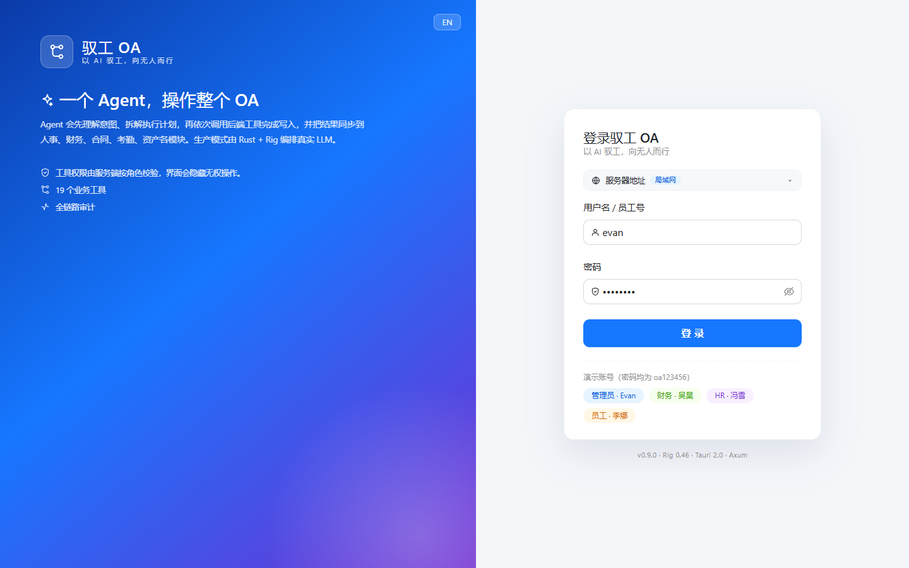
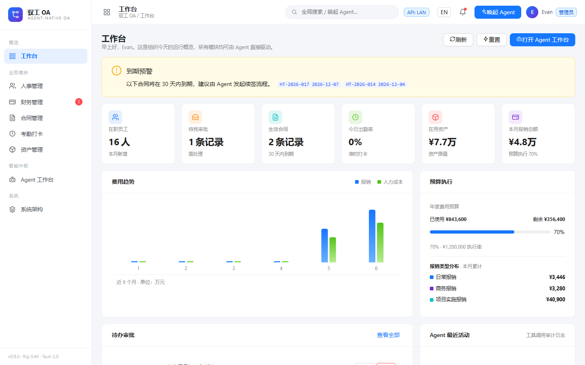
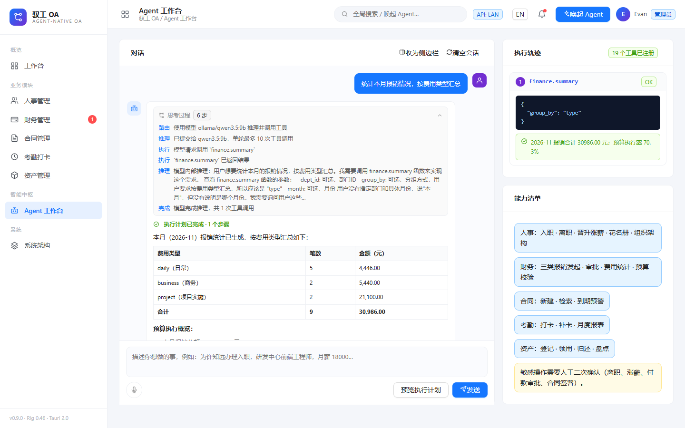
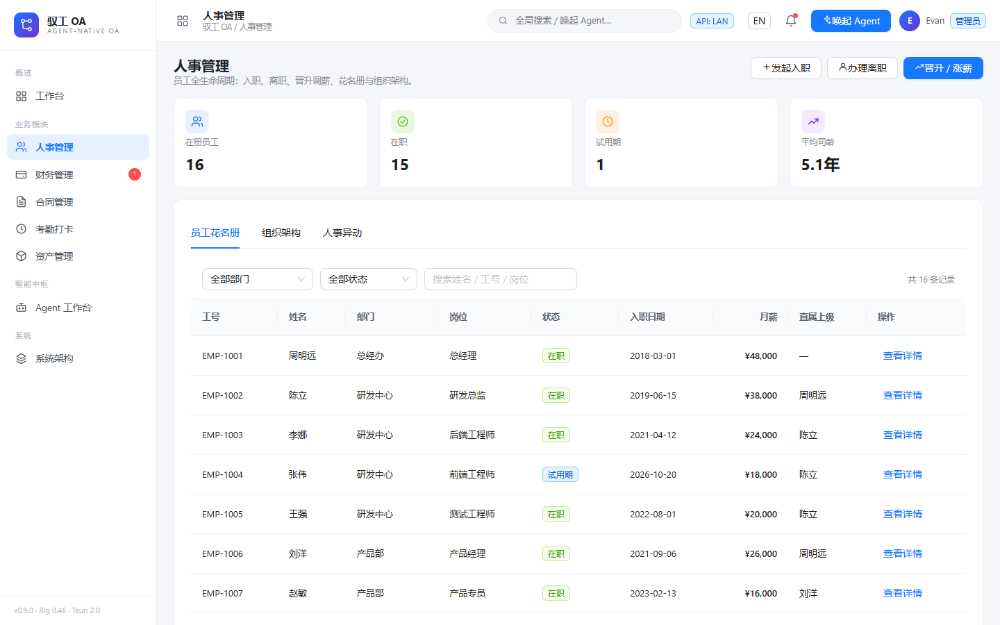
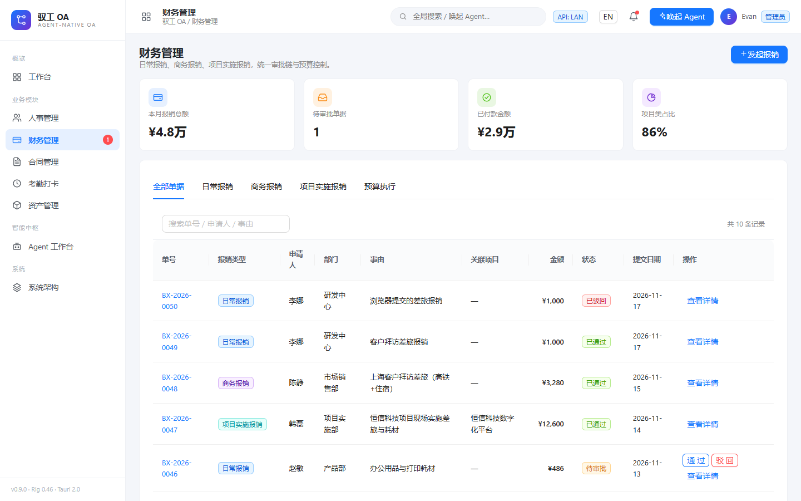
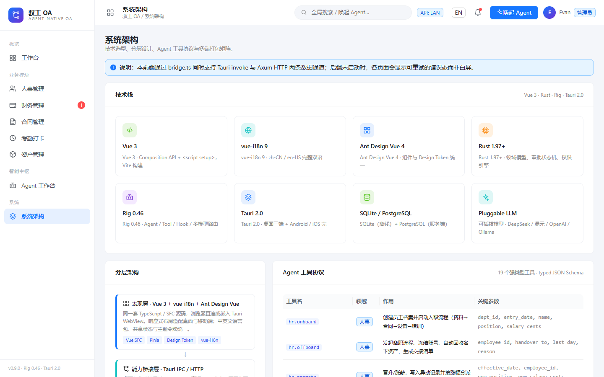

# 驭工 OA · Agent-Native Office Automation

用自然语言驱动全部办公流程的 OA 系统：人事、财务、合同、考勤、资产五大业务域共用
20 个强类型工具，Agent 与表单走同一条写入通道，所有变更落库（SQLite / Postgres）并写审计。

- **前端**：Vue 3 + TypeScript + Ant Design Vue 4 + vue-i18n + Pinia
- **后端**：Rust 1.97+ · Axum 0.8 · Rig 0.46（LLM 编排）· sqlx 0.8（SQLite / Postgres 双后端）
- **外壳**：Tauri 2.0，桌面（Windows / macOS / Linux）与移动端（Android / iOS）共用一套代码
- **客户端形态**：所有平台统一走 REST（无本地数据库、无 invoke 业务通道）；
  登录页配置「局域网 / 外网」两套地址，登录时探测局域网，不可达自动切外网

## 界面预览

| 登录（局域网 / 外网双地址） | 工作台 |
|---|---|
|  |  |

**Agent 工作台**：左侧对话（思考过程可折叠，正文逐字流式输出），右侧实时工具轨迹与能力清单。



| 人事管理 | 财务管理 |
|---|---|
|  |  |

**系统架构**：技术选型、分层架构与 20 个工具的协议一览。



## 目录结构

```
crates/oa-core        领域模型 · 状态机 · 异步 Store（sqlx）· 认证/RBAC · 20 个 Tool · 意图引擎
crates/oa-server      Axum REST 服务（认证、Agent、工具、台账、指标、审计、重置）
src-tauri             Tauri 2.0 薄客户端外壳（窗口/系统集成，业务全部走 REST）
frontend              生产前端（Vue 3 SFC + Vite），唯一前端事实来源
.cargo/config.toml    GNU 目标的链接参数（MinGW ld 导出序号上限）
tools/mingw-bin       随仓库分发的 MinGW-w64（无 VS C++ 工作负载时充当链接器）
tools/check.ps1       Windows 编译检查（自动注入 MinGW + GNU 工具链）
tools/check.sh        同上的 bash 版（Git Bash / WSL）
tools/smoke.ps1       REST 端点冒烟测试（25 项）
tools/tauri.ps1       桌面/移动端开发与打包启动器
docs/screenshots      README 用的界面截图
```

## 一键命令

`tools\*.ps1` 都会自动把 `tools/mingw-bin` 的 MinGW 与 GNU 工具链注入 `PATH`，无需安装
Visual Studio；末尾参数原样透传给底层 CLI（`tauri` / `cargo`）。

| 场景 | 命令 | 结果 |
|---|---|---|
| 桌面开发（热更新） | `.\tools\tauri.ps1 dev` | 起 Vite `:5173` → 编译外壳 → 打开窗口，业务请求直连 oa-server |
| 只出桌面可执行文件 | `.\tools\tauri.ps1 build --no-bundle` | `target\release\oa-app.exe`（客户端，需配合服务端使用） |
| 打完整安装包 | `.\tools\tauri.ps1 build` | 额外产出 MSI / NSIS 安装包（首次需联网下载 WiX、NSIS） |
| 服务端（所有客户端共用） | `cargo run -p oa-server` | REST 服务 `http://0.0.0.0:8787`（局域网可访问） |
| 浏览器前端 | `npm --prefix frontend run dev` | Vite `http://localhost:5173`，直连 8787（服务端已开 CORS） |
| 后端构建 | `cargo build -p oa-server` | `target\debug\oa-server.exe` |
| 类型检查 | `.\tools\check.ps1 --workspace --all-targets` | 只做 `cargo check`，不出产物 |
| 全量校验 | `.\tools\smoke.ps1 -Build` | 重新编译服务端 + 25 项 REST 冒烟（临时库，用完即删） |
| 环境自检 | `.\tools\tauri.ps1 info` | Tauri / Node / Rust 工具链版本与当前配置 |

- 桌面产物按 Tauri 约定：可执行文件在 `target\release\`，安装包在 `target\release\bundle\`。
  本机首次 `tauri.ps1 build` 的 release 编译约 11 分钟，之后增量。
- 任何模式都是**客户端 + 服务端**两个进程：Axum 提供 REST（唯一数据源），
  浏览器 / 桌面 / 移动端只是客户端，换设备登录看到同一份数据。
- 安装包环节要联网拉 WiX / NSIS；网络不通时打包会在 bundle 阶段失败，
  此时用 `--no-bundle`（只出 exe）即可。

## 快速开始

### 1. 依赖

三平台通用前置：**Node 22+**、**Rust stable**、**PowerShell 7（pwsh）**。
`tools/*.ps1` 必须用 pwsh 执行——Windows 自带的 5.1 会按 ANSI 解码脚本里的中文注释，
直接报 `UnexpectedToken` 语法错误。

```bash
npm --prefix frontend install
```

**Windows**

Rust 侧统一使用 **GNU 工具链**（`stable-x86_64-pc-windows-gnu`）：

- 仓库自带 MinGW-w64，位于 `tools/mingw-bin`；脚本会把它和 rustc 的
  `self-contained` 工具目录一起注入 `PATH`，因此无需安装 Visual Studio C++ 工作负载。
- 唯一的 C 依赖是 `libsqlite3-sys`（bundled，编译 `sqlite3.c`），由上面的 MinGW GCC 承担；
  TLS 走系统实现（Windows Schannel / macOS Security.framework），不引入 OpenSSL。
- `.cargo/config.toml` 只为 gnu 目标追加 `-Wl,--exclude-all-symbols`：
  链接 Tauri 的 cdylib 时符号数超过 MinGW ld 的 65535 导出上限，会报
  `export ordinal too large`。msvc 构建不受影响；macOS/Linux 不会命中这个配置。
- 若 `cargo` 仍指向 msvc 且本机缺 `link.exe`/CRT/SDK，执行
  `rustup default stable-x86_64-pc-windows-gnu` 后重试。

**macOS**

```bash
xcode-select --install                    # WebKit 与链接器
rustup target add aarch64-apple-darwin    # Apple Silicon；Intel 机器用 x86_64-apple-darwin
```

**Linux（Debian / Ubuntu 系）**

```bash
sudo apt install -y libwebkit2gtk-4.1-dev build-essential curl wget file \
  libxdo-dev libssl-dev libayatana-appindicator3-dev librsvg2-dev
```

Fedora / Arch 的包名见 Tauri 官方 prerequisites，逻辑一致：需要 WebKitGTK 4.1 + GTK3 + libsoup3。
服务端单独部署时不需要这些桌面依赖（只跑 `oa-server` 即可）。

类型检查（三平台通用）：

```bash
pwsh -File ./tools/check.ps1 --workspace   # Windows 会自动注入 MinGW，mac/linux 直接用默认工具链
bash ./tools/check.sh --workspace          # 没装 pwsh 时的等价选择
```

### 2. 服务端 + 浏览器

开两个终端，服务端与前端各一个：

```powershell
cargo run -p oa-server                 # 终端 1：http://0.0.0.0:8787（局域网可访问）
npm --prefix frontend run dev          # 终端 2：http://localhost:5173
```

服务端默认监听所有网卡（`OA_ADDR` 可改回 `127.0.0.1:8787`）；Windows 首次运行需在
防火墙放行 8787。浏览器打开登录页后，在「服务器地址」里填局域网/外网地址即可。

### 3. 桌面 / 移动端

客户端不再带本地数据库，**必须先启动 oa-server**（同机或局域网/外网均可）：

```bash
pwsh -File ./tools/tauri.ps1 dev                 # 开发：自动起 oa-server + Vite + 编译 + 开窗
pwsh -File ./tools/tauri.ps1 build --no-bundle   # 只出可执行文件（不打包安装包）
pwsh -File ./tools/tauri.ps1 build               # 前端 build + release + 当前平台安装包
```

脚本内部按平台分流：Windows 注入 MinGW 并切 GNU 工具链，macOS/Linux 直接用 rustup 默认工具链，
结束服务端统一用 `Kill(entireProcessTree)`（不再依赖 `taskkill.exe`），因此三平台同一套命令。

等价的原始命令（在 `frontend` 目录执行）：`npm run tauri -- dev` / `npm run tauri -- build`。

移动端：`pwsh -File ./tools/tauri.ps1 android init`（或 `ios init`）之后，用
`pwsh -File ./tools/tauri.ps1 android dev` / `android build`；真机调试时 Tauri 会注入
`TAURI_DEV_HOST`，Vite 自动监听局域网地址。

### 4. 客户端地址配置（局域网优先）

登录页「服务器地址」可折叠面板里配置两套地址，保存在本机 localStorage：

| 项 | 示例 | 说明 |
|---|---|---|
| 局域网 | `http://192.168.1.10:8787` | 办公网直连，延迟低 |
| 外网 | `https://oa.example.com` | 跨网/远程，通常经反向代理 |

登录与刷新恢复会话时：先探测局域网的 `/api/health`（1.2s 超时），可达即用局域网，
否则自动切外网；两者都不通则提示检查地址。顶栏 `API` 标签显示当前生效模式，悬停可见实际地址。
「测试连接」只做探测与提示，不会改变当前生效地址。

平台差异（局域网多为明文 HTTP）：

- **iOS / macOS**：已通过 `src-tauri/Info.plist` 打开 ATS（`NSAllowsArbitraryLoads` + `NSAllowsLocalNetworking`）；
- **Android**：Tauri release 默认禁止明文 HTTP。`android init` 后在
  `src-tauri/gen/android/app/src/main/AndroidManifest.xml` 的 `<application>` 上加
  `android:usesCleartextTraffic="true"`（或配 `network_security_config` 只放行内网段）；
- **Windows / Linux**：WebView 不限制明文，只需放行防火墙端口。

## 演示账号

密码统一 `oa123456`，可在登录页点选填充。

| 用户名 | 员工 | 角色 | 典型权限 |
|---|---|---|---|
| `evan` | E01 周明远 | admin | 全部 20 个工具 |
| `wuhao` | E10 吴昊 | finance | 报销审批/汇总、合同创建、考勤报表 |
| `fengxue` | E12 冯雪 | hr | 入职/离职/晋升、资产登记/领用、考勤报表 |
| `chenli` | E02 陈立 | manager | 报销审批、领用/归还、合同创建、团队数据 |
| `lina` | E03 李娜 | employee | 报销申请、打卡/补卡、查询类工具 |

RBAC 在服务端执行（`crates/oa-core/src/auth.rs` 的 `can_use` 矩阵），前端只做 UI 隐藏；
客户端直调 HTTP 无法绕过。被拒绝的调用同样写审计。

## Agent 运行模式

通过 `OA_AGENT_MODE` 控制，三种取值共用同一套 20 个工具、RBAC 与审计：

| 值 | 行为 |
|---|---|
| `auto`（默认） | 有 `OPENAI_API_KEY` 走真实 LLM，否则走本地意图引擎 |
| `local` | 强制离线确定性引擎，**不依赖任何外部密钥**即可跑通全部流程 |
| `llm` | 强制 Rig + 模型；失败且尚未执行任何工具时自动回退本地引擎 |

模型可插拔：`OA_MODEL`（默认 `gpt-4o-mini`）、`OPENAI_BASE_URL`（OpenAI 兼容端点）。
LLM 模式下前端轨迹来自审计表，模型实际调用了哪些工具一目了然。

敏感操作（离职、涨薪、报销审批、合同创建）强制人工确认：
Agent 返回 `needs_confirmation` + `pending`，前端确认后带 `confirmed=true` 重试；未确认不写库。

## REST API

除 `/api/health`、`/api/auth/login` 外均需 `Authorization: Bearer <token>`。

| 方法 | 路径 | 说明 |
|---|---|---|
| GET | `/api/health` | 健康检查 |
| POST | `/api/auth/login` | `{username,password}` → `{token,user}` |
| POST | `/api/auth/logout` | 吊销当前令牌 |
| GET | `/api/auth/me` | 当前会话用户 |
| POST | `/api/auth/change-password` | 改密并吊销该账号全部会话 |
| POST | `/api/agent/chat` | Agent 对话（回复 + 模式 + 轨迹 + 待确认步骤） |
| POST | `/api/agent/plan` | 计划预览（不写库） |
| GET | `/api/tools` | 20 个工具及当前角色 `allowed` |
| POST | `/api/tools/call` | 单工具直调（表单写操作统一入口） |
| POST | `/api/files` | 上传附件/发票图片（base64，`entity_type=claim|contract`） |
| GET | `/api/files?entity_type=&entity_id=` | 附件列表（按单据） |
| GET | `/api/files/{id}` | 读取附件内容（返回 data URL） |
| DELETE | `/api/files/{id}` | 删除附件（上传者或管理员） |
| GET | `/api/tables/{name}` | 只读台账（表名白名单，共 15 张） |
| GET | `/api/metrics` | 工作台 KPI + 近 6 月趋势 |
| GET | `/api/audit?limit=` | 审计日志 |
| POST | `/api/seed/reset` | 重置演示数据（管理员；账号保留） |
| GET | `/api/settings/llm` | 当前模型配置（管理员；Key 只回掩码） |
| POST | `/api/settings/llm` | 保存模型配置（管理员；`api_key` 留空=沿用，`clear=true`=清除） |
| POST | `/api/settings/llm/test` | 用当前配置发一次最小调用验证连通性（管理员） |
| GET | `/api/features` | 验收矩阵（与 `domain::FEATURES` 同源） |

**所有客户端（Windows / macOS / Linux / Android / iOS / 浏览器）都调用上表同一套 REST**，
Tauri 外壳内没有任何业务命令；服务端地址由登录页配置、登录时自动选择（见「客户端地址配置」）。

## 附件 / 发票图片

发票、报销凭证、合同扫描件走**同一条上传通道**，桌面端与浏览器端没有分叉：

- 前端把文件读成 base64 走 `POST /api/files`（`entity_type` / `entity_id` /
  `file_name` / `mime` / `data_base64`），客户端不保存任何本地路径；
- 服务端校验类型（PNG / JPG / WEBP / GIF / PDF）与大小（≤ 10 MB），再落盘到
  `OA_FILES`（默认 `oa-files/`），库里只存相对路径与元数据；
- 可见性跟业务单据一致：报销单本人或财务/经理范围，合同仅财务/经理（与 `contract.create` 同源）；
- 读取返回 data URL，前端 `` / 内嵌预览直接用，不需要额外的静态文件服务；
- 重置演示数据会同时清空 `attachments` 表与落盘文件。

## 模型配置（仅管理员）

右上角头像菜单 →「模型设置」，管理员可在界面里切换提供商，配置立即生效：

| 提供商 | 默认 Base URL | 默认模型 | Key |
|---|---|---|---|
| DeepSeek | `https://api.deepseek.com/v1` | `deepseek-chat` | 必填 |
| Qwen · DashScope | `https://dashscope.aliyuncs.com/compatible-mode/v1` | `qwen-plus` | 必填 |
| vLLM · 自建 | `http://127.0.0.1:8000/v1` | `Qwen2.5-7B-Instruct` | 可空 |
| Ollama · 本地 | `http://127.0.0.1:11434/v1` | `qwen2.5:7b` | 可空 |
| OpenAI | `https://api.openai.com/v1` | `gpt-4o-mini` | 必填 |

- 五家都是 OpenAI 兼容端点，共用同一条 Rig 客户端路径；Base URL 与模型名可手改。
- 配置存 `settings` 表（SQLite / Postgres 同表），优先级：界面配置 > 环境变量 > 离线引擎。
- **API Key 明文只存服务端**：接口只返回 `sk-ab…7890` 形式的掩码，保存时留空即沿用旧 Key。
- 「测试连接」会按当前配置发一次最小对话，失败时返回完整因果链（连接被拒 / 401 等）。
- 界面入口与 `GET/POST /api/settings/llm` 都做了管理员校验，非管理员 403。

## 费用标准

报销明细按费用类型做标准校验（`domain::CLAIM_ITEM_STANDARDS`，改标准只改这一个常量）：

| 类型 | 标准（单条明细上限） | 类型 | 标准 |
|---|---|---|---|
| 交通 `transport` | 5000 元/次（含往返、多段） | 办公用品 `office` | 3000 元/次 |
| 住宿 `hotel` | 5000 元/次（多晚合计） | 其他 `other` | 5000 元/次 |
| 餐饮 `meal` | 1000 元/人次 | | |

- 单条明细**超标必须填写说明**，否则整单拒绝（事务回滚，不落库），错误信息会指出第几条、超了多少；
- 超标但已说明的照常入库，创建结果返回 `over_standard_count` / `over_standard_items`，
  台账 `claim_items` 额外带 `standard_cents` / `over_standard`，审批人在详情里直接看到「超标」标记；
- 明细类别受白名单约束（不在列表里的类别直接拒绝），未知类别不参与标准校验；
- 前端同口径实时提示并在提交前拦截，后端 `parse_claim_items` 是最终裁决。

## 考勤

- 打卡：上班 / 下班各一条，按 09:00 / 17:30 判定迟到早退，工时扣 1 小时午休；
- 补卡：只创建 `makeup_requests` 与审批流（审批人 = 直属主管，存员工号），**审批通过后才写入 `attendance`**，
  驳回不写；同一人同一天只允许一条待审批，补未来日期直接拒绝；
- 月度报表：`attendance.report` 与考勤页同一口径，按人汇总出勤天数 / 正常 / 迟到 / 早退 / 缺卡 / 外勤 / 请假 / 工时 / 出勤率
  （出勤率 =（正常 + 外勤）/ 出勤天数），并返回待审批补卡数；
- 行级可见性：普通员工只看本人考勤与本人补卡，HR / 财务 / 经理可看全员。

## 20 个工具

| 域 | 工具 |
|---|---|
| 人事 | `hr.onboard` `hr.offboard` `hr.promote` `hr.approve` `hr.roster.query` |
| 组织 | `org.chart` |
| 财务 | `finance.claim.create` `finance.claim.approve` `finance.summary` |
| 合同 | `contract.create` `contract.approve` `contract.query` |
| 考勤 | `attendance.checkin` `attendance.makeup` `attendance.approve` `attendance.report` |
| 资产 | `asset.register` `asset.assign` `asset.return` `asset.query` |

## 环境变量

| 变量 | 默认值 | 说明 |
|---|---|---|
| `OA_DB` | `oa.db` | 数据源：SQLite 文件路径，或 `postgres://` / `postgresql://` 走 Postgres（仅服务端使用） |
| `OA_ADDR` | `0.0.0.0:8787` | 监听地址；仅本机访问请设为 `127.0.0.1:8787` |
| `OA_FILES` | `oa-files` | 附件落盘目录（仅服务端使用，多实例部署需共享卷） |
| `OA_INSTANCE` | `local` | `/api/health` 返回的实例标识，便于确认请求落到哪个副本 |
| `OA_PG_POOL` | `10` | Postgres 连接池上限（SQLite 固定单连接 + WAL） |
| `OA_AGENT_MODE` | `auto` | `auto` / `local` / `llm` |
| `OA_MODEL` | `gpt-4o-mini` | 模型名 |
| `OPENAI_API_KEY` | — | 未设置时自动走本地引擎 |
| `OPENAI_BASE_URL` | — | OpenAI 兼容端点 |
| `VITE_API_BASE` | `http://127.0.0.1:8787` | 兜底地址：登录页未配置时使用 |
| `VITE_API_LAN` | 同 `VITE_API_BASE` | 局域网地址默认值（登录页可改，落 localStorage） |
| `VITE_API_WAN` | 同 `VITE_API_BASE` | 外网地址默认值（登录页可改，落 localStorage） |
| `VITE_RELEASE_BASE` | 仓库 `releases/latest` | 登录页「客户端下载」的下载基址（桌面端跳发布页，服务端直链 `download/oa-server.exe`） |

`OPENAI_API_KEY` / `OPENAI_BASE_URL` / `OA_MODEL` 只是**回退**：管理员在「模型设置」里保存过配置后
以界面配置为准；`OA_AGENT_MODE=local` 则始终强制离线意图引擎，忽略以上所有模型配置。

## 验证

```powershell
.\tools\check.ps1 --workspace --all-targets   # 编译检查（含测试目标）
cargo test --workspace                         # 52 个单测（oa-core）
npm --prefix frontend run build                # vue-tsc + 生产构建
.\tools\smoke.ps1 -Build                       # 重编译服务端 + 25 项 REST 冒烟（临时库）
.\tools\tauri.ps1 build --no-bundle            # 桌面 release 构建（离线，出 exe）
```

冒烟脚本需在 PowerShell 7（`pwsh`）下运行；`-Build` 参数会先用仓库自带 MinGW 重新编译服务端。

单测覆盖：状态机、审批链（报销/合同均逐级流转）、金额归一化、种子数据幂等、认证/RBAC、拒绝审计、
台账行级可见性、本人数据作用域、异步 Store 的并发自增、事务回滚、
本地引擎多步编排与确认门禁、权限不足不写库、模型配置的提供商预设与 Key 掩码。

## 发布

发布物 = 桌面安装包（MSI + NSIS）+ 服务端可执行文件 + 更新清单 `latest.json`，三者版本必须一致。

### 本地手动发布

```powershell
# 1. 三处版本号改齐（Cargo.toml / tauri.conf.json / package.json），然后自检
pwsh -NoProfile -File .\tools\release-check.ps1 -Version v0.2.0

# 2. 打安装包（overlay 打开更新产物，需要签名私钥）
$env:TAURI_SIGNING_PRIVATE_KEY = 'C:\Users\<you>\.tauri\oa-updater.key'
.\tools\tauri.ps1 build --config src-tauri/tauri.updater.conf.json

# 3. 出服务端
cargo build -p oa-server --release

# 4. 生成更新清单
pwsh -NoProfile -File .\tools\make-updater-json.ps1 -Version v0.2.0
```

产物在 `target\release\bundle\`（`msi\*.msi`、`nsis\*-setup.exe`、各自 `.sig`、`latest.json`）。
`createUpdaterArtifacts` 只在 `src-tauri/tauri.updater.conf.json` 里打开，所以日常 `tauri.ps1 build`
不需要私钥；一旦带上这个 overlay 却没有 `TAURI_SIGNING_PRIVATE_KEY`，打包会直接失败。

### 自动发布（GitHub Actions）

| 工作流 | 触发 | 干什么 |
|---|---|---|
| `ci.yml` | push main / PR | Rust `check` + `test`（Windows）、前端 `vue-tsc` + `vite build`、服务端镜像可构建 |
| `release.yml` | 推 `v*` tag 或手动 | 版本一致性校验 → 打安装包（可选代码签名）→ 出 `oa-server.exe` → 生成 `latest.json` → 建 draft Release |
| `docker.yml` | 推 `v*` tag 或手动 | 构建并推送 `ghcr.io/<owner>/<repo>/oa-server:{版本,latest}` |

流程：改版本号 → 提交 → `git tag -a v0.2.0 -m "..."` → `git push origin v0.2.0` → 等 Actions 出 draft →
人工核对后点 **Publish release**。只有正式发布的 release 才能被
`releases/latest/download/latest.json` 命中，等于给自动更新留了人工闸门。

需要配置的 Secrets：

| Secret | 作用 | 是否必需 |
|---|---|---|
| `TAURI_SIGNING_PRIVATE_KEY` | 更新包签名私钥（`~/.tauri/oa-updater.key` 的内容或其路径） | 必需 |
| `TAURI_SIGNING_PRIVATE_KEY_PASSWORD` | 私钥口令（生成时未设密码则留空） | 可选 |
| `WINDOWS_CERTIFICATE_BASE64` | 代码签名证书 `.pfx` 的 base64 | 可选 |
| `WINDOWS_CERTIFICATE_PASSWORD` | 证书口令 | 配了证书则必需 |

公钥已写入 `tauri.conf.json` 的 `plugins.updater.pubkey`，它与私钥是一对。
**私钥丢失 = 已有的客户端再也无法收到自动更新**（只能让用户手动重装新版本），务必离线备份。

### 服务端部署

服务端只有 Windows 和 Linux 两个目标，二进制与镜像行为一致：默认监听 `0.0.0.0:8787`，
数据 = 一个 SQLite 文件 + 一个附件目录，升级只换可执行文件。

**Linux · Docker（推荐）**

```bash
docker run -d --name oa-server -p 8787:8787 -v oa-data:/data \
  -e OA_INSTANCE=prod-1 ghcr.io/kingemma/agent-native-office-automation/oa-server:0.1.0
```

**Linux · systemd（裸机）**

```bash
sudo useradd --system --home /opt/oa oa
sudo install -d -o oa -g oa /opt/oa /var/lib/oa
sudo install -m 0755 target/release/oa-server /opt/oa/oa-server
sudo install -m 0644 deploy/oa-server.service /etc/systemd/system/
sudo systemctl daemon-reload && sudo systemctl enable --now oa-server
sudo ufw allow 8787/tcp            # firewalld：firewall-cmd --add-port=8787/tcp --permanent
```

**Windows**

```powershell
cargo build -p oa-server --release
pwsh -File .\deploy\install-windows.ps1 -Source .\target\release\oa-server.exe
```

脚本会复制到 `C:\oa`、注册开机自启的计划任务（SYSTEM、崩溃自动重启）、放行入站 8787、
启动后轮询 `/api/health` 确认就绪。之所以用计划任务而不是 `sc create`：oa-server 是普通
控制台程序，没实现 SCM 接口，直接注册服务会因「服务未及时响应启动请求」失败。

**局域网访问**

- 服务端绑定 `0.0.0.0:8787`（默认），不要改成 `127.0.0.1`，否则同网段设备连不上。
- 放行端口：Windows `New-NetFirewallRule -DisplayName 'Yugong OA 8787' -Direction Inbound -Protocol TCP -LocalPort 8787 -Action Allow`；
  Linux `ufw allow 8787/tcp`。
- 客户端在登录页「服务器地址 → 局域网」填 `http://<服务器IP>:8787`；打包时也可以用
  `VITE_API_LAN=http://192.168.1.10:8787` 作为出厂默认值，运行时仍以用户输入为准。
- 服务端已开 `CorsLayer` 允许任意来源，桌面端、浏览器、手机都能直连，不需要额外代理。

镜像内置 `HEALTHCHECK`（探 `/api/health`），首次启动自动建库并灌演示数据，
**上线前必须改掉演示口令 `evan / oa123456`** 并清理演示数据（管理员调用 `POST /api/seed/reset`）。

## 数据与安全

- 金额统一「分」存储；日期统一 `YYYY-MM-DD`；单号由 `next_id` 递增生成（并发安全）。
- 存储层是异步仓储：`Store` 内部持有 `sqlx` 连接池（SQLite 单连接 + WAL，Postgres 走
  `OA_PG_POOL`），HTTP 与 Tauri 两个入口直接 `.await` 同一套方法，不存在全局 `Mutex`。
- 密码加盐多轮 SHA-256 存储，会话 7 天有效，改密即吊销全部令牌。
- 审计表记录工具名、真实操作者（员工号）、入参、结果，失败与拒绝同样留痕。
- 台账白名单不包含 `users` / `sessions`，避免泄露账号信息。
- 演示 seed 幂等：空库自动灌入，重置只清业务数据，不覆盖账号与密码。
